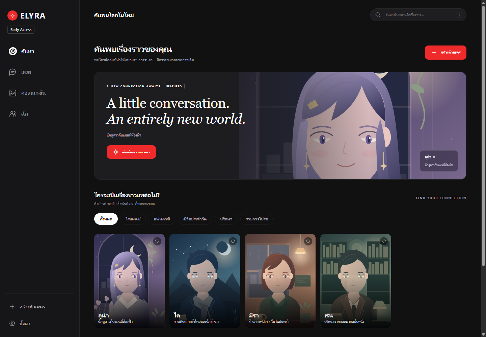
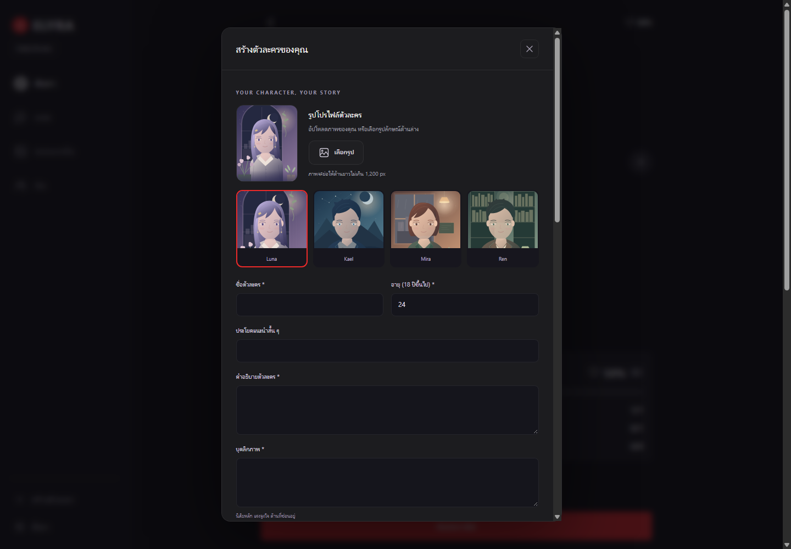
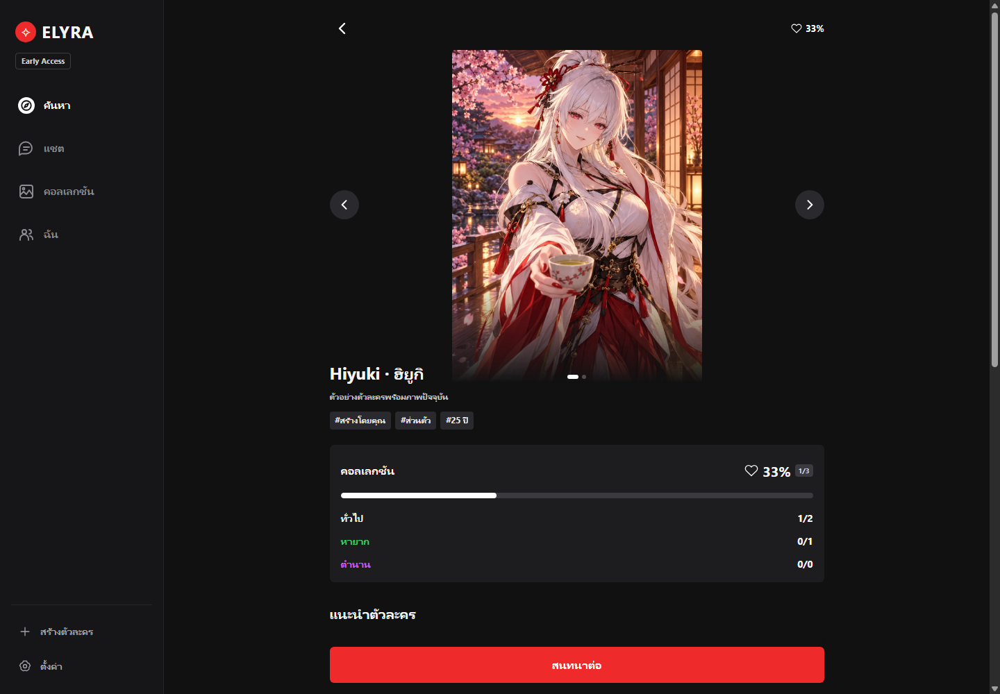
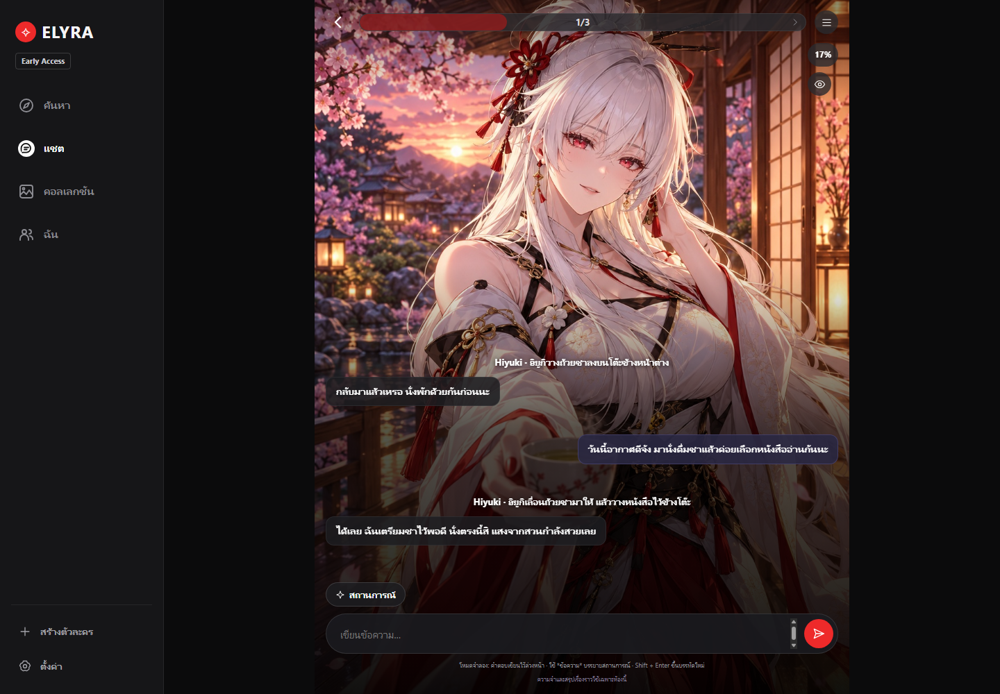
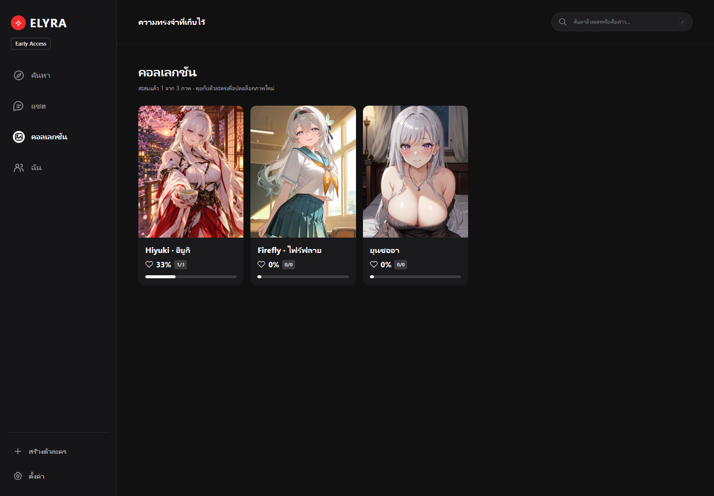
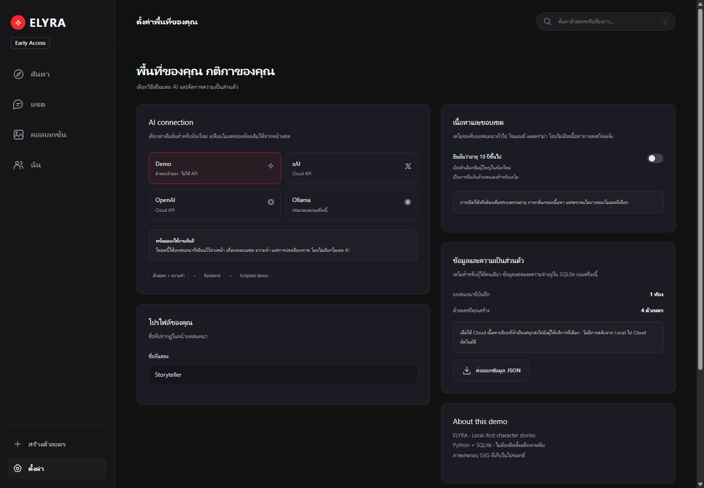
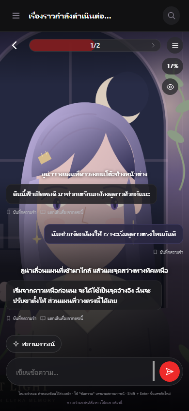

# ELYRA — AI Character Roleplay

สร้างตัวละคร เขียนเรื่องราวร่วมกับ AI และสะสมภาพตามสถานการณ์ ผ่านเว็บบนคอมพิวเตอร์หรือมือถือ เลือกใช้ **xAI / OpenAI / Ollama** หรือทดลองด้วย **Demo** โดยไม่ใช้ API key ข้อมูลตัวละคร แชต และความจำเก็บใน SQLite ของแอป

**สถานะ:** MVP ผู้ใช้เดียวในเครื่องหรือ LAN · Python 3.11+ · Python standard library · ไม่ต้องใช้ npm หรือ pip install



> ภาพคู่มือถ่ายจากแอปจริงด้วยฐานข้อมูลตัวอย่าง ใช้ SVG ของโปรเจกต์และบทสนทนาที่เขียนเพื่อสาธิต ไม่ใช่ข้อมูลส่วนตัวหรือผลทดสอบคุณภาพโมเดล ตัวละครในภาพไม่ได้ติดตั้งพร้อม Git clone และหน้าจอบางส่วนอาจต่างตามรุ่นโค้ด

## สารบัญ

- [ติดตั้งและเริ่มใช้งาน](#quick-start)
- [คู่มือใช้งานพร้อมภาพ](#usage)
- [เชื่อมต่อ AI และสร้างภาพ](#providers)
- [Deploy โค้ด](#deploy)
- [อัปเดต สำรอง และกู้ข้อมูล](#backup)
- [แก้ปัญหา](#troubleshooting)
- [โครงสร้างและการทดสอบ](#development)

<a id="quick-start"></a>
## ติดตั้งและเริ่มใช้งาน

เตรียม **Python 3.11 ขึ้นไป**, **Git** และเบราว์เซอร์ บน Windows ให้เลือกเพิ่ม Python ลง PATH ตอนติดตั้ง เปิด PowerShell แล้วรัน:

```powershell
git clone https://github.com/9ter/ELYRA-AI.git
cd ELYRA-AI
python --version
python app.py
```

เปิด **http://localhost:3000** และคงหน้าต่าง Python ไว้ กด `Ctrl+C` ในหน้าต่างนั้นเพื่อหยุด หากเครื่องใช้คำสั่ง `py` ให้ใช้ `py -3 app.py` บน macOS/Linux ใช้ `python3 app.py`; สคริปต์ .bat และ firewall ใช้เฉพาะ Windows

แอปสร้าง `.data/elyra.db` อัตโนมัติ เริ่มจาก **Demo** เพื่อทดลองหน้าจอได้ทันที คำตอบเป็นข้อความจำลอง ไม่ใช่โมเดล AI และไม่เสียค่า API

<a id="usage"></a>
## คู่มือใช้งานพร้อมภาพ

### 1. สร้างตัวละคร

กด **สร้างตัวละคร** ในเมนูด้านซ้ายหรือมุมบนของหน้าแรก เลือกรูปสำเร็จรูปหรืออัปโหลดรูป กรอกข้อมูล แล้วเลื่อนลงท้ายฟอร์มเพื่อบันทึก



| ช่อง | ใส่อะไร | ตัวอย่าง |
| --- | --- | --- |
| ชื่อ / อายุ | ชื่อในเรื่องและอายุอย่างน้อย 18 ปี | ลูน่า / 25 |
| คำอธิบาย | เป็นใครและเรื่องราวเกี่ยวกับอะไร | นักดูดาวที่ดูแลหอดูดาวของชุมชน |
| บุคลิกภาพ | นิสัย เป้าหมาย และวิธีตอบสนอง | อบอุ่น ช่างสังเกต มีความเห็นของตัวเอง |
| บุคลิกแบบละเอียด | น้ำเสียง ตัวอย่างบทสนทนา สิ่งที่ชอบ/ไม่ชอบ | พูดสั้นเมื่อจดจ่อ อธิบายมากขึ้นเมื่อคุยเรื่องดาว |
| ประวัติ / ความสัมพันธ์ | โลกของตัวละครและจุดเริ่มต้นของผู้เล่น | เพื่อนบ้านที่มาช่วยเตรียมคืนชมดาว |
| เคล็ดลับเริ่มเรื่อง | แนวทางที่ผู้เล่นอ่านเห็นได้ | ลองช่วยจัดกล้องหรือชวนคุยเรื่องกลุ่มดาว |
| ข้อความเปิดบทสนทนา | ข้อความแรกในห้องใหม่ | `*วางแผนที่ลงบนโต๊ะ* คืนนี้ฟ้าเปิดพอดี` |

รูปต้นฉบับรองรับ PNG/JPEG/WebP ไม่เกิน 10 MB เบราว์เซอร์ย่อด้านยาวไม่เกิน 1,200 px และแปลงก่อนส่ง ภาพที่เก็บต้องเป็น PNG/JPEG ไม่เกิน 2 MiB

หน้า **ฉัน** ใช้แก้ไข ทำสำเนา เก็บเข้าคลัง และนำตัวละครกลับมา หากหน้าแรกว่าง ให้สร้างตัวละครก่อน UI ซ่อน Luna/Kael/Mira/Ren ที่ backend เตรียมไว้

### 2. เปิดโปรไฟล์และเริ่มเรื่อง

กดการ์ดในหน้า **ค้นหา** เพื่อดูรูป คำแนะนำ และความคืบหน้าคอลเลกชัน จากนั้นกดปุ่มเริ่มสนทนาด้านล่าง หากมีห้องแล้ว ปุ่มจะพากลับไปสนทนาต่อ



การ clone โค้ดไม่คัดลอกตัวละครหรือประวัติจากเครื่องผู้พัฒนา คุณสร้างตัวละครและอัปโหลดภาพของตัวเองได้

### 3. สนทนาและจัดการความจำ

พิมพ์ในช่องล่างแล้วกดส่ง ใช้ `*ข้อความ*` สำหรับบรรยายการกระทำ และ `Shift+Enter` เพื่อขึ้นบรรทัดใหม่ ปุ่ม **สถานการณ์** ช่วยเริ่มฉาก เมนูมุมบนขวาเปิดรายละเอียดห้องและตัวเลือกที่เกี่ยวข้อง



- **บันทึกความจำ** ใต้ข้อความ: เก็บข้อเท็จจริงสำคัญเฉพาะห้อง เพิ่มหรือลบได้
- **สรุปเรื่องราว · AUTO**: สรุปแชตส่วนเก่าเบื้องหลังเมื่อยาวถึงเกณฑ์ การรีเฟรชสถานะไม่เรียก AI เพิ่ม; Demo ไม่เรียกโมเดลสรุป บันทึกเดิมที่เขียนเองยังอยู่
- **แตกเส้นเรื่องจากตรงนี้**: สร้างห้องใหม่ถึงข้อความที่เลือก พร้อมความจำก่อนจุดนั้น ห้องเดิมยังอยู่ และสรุปห้องใหม่เริ่มว่างเพื่อไม่ให้เหตุการณ์อนาคตติดไป
- **เริ่มบทใหม่**: เปิดห้องแยกโดยไม่ล้างเรื่องเดิม การลบห้องจะลบข้อความ ความจำ และประวัติปลดล็อกของห้องนั้นด้วย
- **เปลี่ยน provider/model ในห้อง**: ใช้ประวัติและความจำของแอปต่อได้ ไม่มีการสลับจาก Ollama ไป Cloud อัตโนมัติเมื่อเชื่อมต่อไม่ได้

ห้องเดิมเก็บบุคลิก ณ วันที่เริ่มห้อง การแก้บุคลิกใช้กับห้องใหม่ ส่วนรูปโปรไฟล์และรายการภาพฉากใช้ข้อมูลล่าสุดและเปลี่ยนในห้องเดิมได้ AI อาจตีความผิดหรือใช้สำนวนซ้ำ แม้มีแนวทางรักษาความต่อเนื่องและเปิดจังหวะให้ผู้เล่นเลือกต่อ

### 4. เพิ่มภาพฉากและดูคอลเลกชัน

ไปที่ **ฉัน → แก้ไขตัวละคร → ภาพตามสถานการณ์** เพิ่มภาพพร้อมคำอธิบายสถานที่ การกระทำ และอารมณ์ เช่น “นั่งอ่านแผนที่ดาวที่โต๊ะในหอดูดาว บรรยากาศสงบ” แล้วบันทึก

ระหว่างเล่น AI เลือกภาพที่เข้ากับเรื่อง ภาพจะแสดงเป็นพื้นหลังและสะสมเมื่อปรากฏครั้งแรก **ไม่ได้ปลดล็อกตามจำนวน 1/3/6 รอบแล้ว** เปอร์เซ็นต์ความคืบหน้าทั่วไปในห้องไม่ใช่จำนวนภาพสะสม ให้ดูจำนวนภาพในคอลเลกชันแยกต่างหาก



กดตัวละครในหน้า **คอลเลกชัน** เพื่อดูรายละเอียด ภาพสาธิตเตรียมสถานะไว้เพื่ออธิบายหน้าจอ ไม่ได้ใช้ Demo ทดสอบการเลือกฉากของ AI

### 5. ตั้งค่าโมเดลและส่งออกข้อมูล

เข้า **ตั้งค่า** เลือกผู้ให้บริการ ตรวจสอบการเชื่อมต่อ เลือกหรือกรอกโมเดลที่บัญชีใช้ได้ แล้วเลื่อนลงกด **บันทึกการตั้งค่า** ค่าเริ่มต้นใช้กับห้องใหม่ ห้องเดิมเปลี่ยนในหน้าห้อง



หน้านี้มีชื่อที่แสดง การยืนยันอายุ และ **ส่งออกข้อมูล JSON** รวมตัวละคร ห้อง ข้อความ ความจำ สรุป และรูปอัปโหลด เก็บไฟล์ส่งออกเป็นส่วนตัว ปัจจุบันยังไม่มีหน้าจอนำเข้า JSON จึงควรสำรองฐานข้อมูลด้วยหากต้องการกู้ทั้งแอป

### 6. ใช้บนมือถือ

เปิดเบราว์เซอร์มือถือผ่าน IP พีซีตามขั้นตอน LAN ด้านล่าง แตะเมนูสามขีดเพื่อสลับหน้า ไม่ต้องติดตั้งแอปมือถือแยก



<a id="providers"></a>
## เชื่อมต่อ AI และสร้างภาพ

| โหมด | ต้องเตรียม | ประมวลผลที่ไหน |
| --- | --- | --- |
| Demo | ไม่ต้องมี key | คำตอบจำลองในแอป |
| xAI | `XAI_API_KEY` และโมเดลที่บัญชีเข้าถึงได้ | Cloud ของ xAI |
| OpenAI | `OPENAI_API_KEY` และโมเดลที่บัญชีเข้าถึงได้ | Cloud ของ OpenAI |
| Ollama | เปิด Ollama และดาวน์โหลดโมเดล | เครื่องเดียวกับ Python |

### Cloud API

สร้าง `.env` จากตัวอย่าง **ครั้งแรกเท่านั้น** หากมีอยู่แล้วให้แก้ไฟล์เดิม:

```powershell
Copy-Item .env.example .env
notepad .env
```

กรอกเฉพาะบริการที่ใช้ ข้างล่างเป็น placeholder ไม่ใช่ key จริง:

```dotenv
XAI_API_KEY=YOUR_XAI_KEY
OPENAI_API_KEY=YOUR_OPENAI_KEY
XAI_MODEL=
OPENAI_MODEL=
OLLAMA_BASE_URL=http://127.0.0.1:11434
OLLAMA_MODEL=
```

หยุดแล้วเริ่มแอปใหม่หลังแก้ `.env` จากนั้นเลือกบริการและโมเดลในหน้า **ตั้งค่า** การตรวจสอบการเชื่อมต่ออ่านรายการโมเดล การส่งแชตและงานสรุป/เลือกฉากเบื้องหลังอาจมีค่าใช้จ่าย โมเดลสนทนากับโมเดลงานเบื้องหลังตั้งแยกได้

key อยู่ฝั่งเซิร์ฟเวอร์ ไม่ใส่ใน `public/` หรือ commit ขึ้น Git ค่า environment ที่มีอยู่แล้วมีลำดับก่อน `.env`; xAI อ่าน `xAi_api_key.text` เป็น fallback เมื่อไม่มี `XAI_API_KEY`

### Ollama

เปิด Ollama บนเครื่องเดียวกับ Python ดาวน์โหลดโมเดลที่เลือก แล้วไป **ตั้งค่า → Ollama → ตรวจสอบการเชื่อมต่อ → เลือกโมเดล → บันทึก** ค่าเริ่มต้นคือ `http://127.0.0.1:11434` แอปอนุญาตเฉพาะ loopback และไม่ fallback ไป Cloud

เมื่อใช้มือถือ Ollama ยังรันบนพีซีที่เปิด ELYRA คุณภาพภาษาไทยและความเร็วขึ้นกับโมเดลและฮาร์ดแวร์

### Forge / A1111 สำหรับสร้างภาพ (ไม่บังคับ)

ติดตั้งและเปิด API ของ Stable Diffusion WebUI แยกจาก ELYRA ค่าเริ่มต้น `http://127.0.0.1:7860` เปลี่ยนได้ด้วย `FORGE_URL` ฝั่งเซิร์ฟเวอร์ จากนั้นตรวจการเชื่อมต่อในส่วนตั้งค่าภาพ

กำหนด image prompt, negative prompt และ LoRA ในตัวละคร แล้วใช้ **สร้างภาพด้วย AI** ตรวจว่า checkpoint และ LoRA เป็นตระกูลที่เข้ากัน เช่น LoRA SDXL/Illustrious ใช้กับ checkpoint SD1.5 โดยตรงไม่ได้ หากไม่ใช้การสร้างภาพ ให้อัปโหลดรูปเองได้

<a id="deploy"></a>
## Deploy โค้ด

โปรเจกต์ต้องมี **Python process ทำงานต่อเนื่องและดิสก์เขียน SQLite ได้** GitHub เก็บโค้ด ส่วน GitHub Pages ให้บริการไฟล์ static จึงรัน backend นี้ไม่ได้ ยังไม่มี Docker/VPS deployment template หรือระบบหลายบัญชีพร้อมใช้งาน

### A. ใช้เฉพาะเครื่องนี้

หลัง clone และตั้งค่าแล้ว:

```powershell
python app.py --port 3000
```

เปิด `http://localhost:3000` ค่าเริ่มต้นรับเฉพาะ loopback ไม่เปิด tunnel เอง วิธีนี้ใช้ได้โดยไม่พึ่ง background launcher

### B. ให้มือถือใน Wi-Fi เดียวกันใช้งาน

1. หยุดเซิร์ฟเวอร์เดิมด้วย `Ctrl+C` หรือเครื่องมือหยุดของ launcher ที่ใช้อยู่
2. รัน `ipconfig` หา IPv4 ของ Wi-Fi/Ethernet ที่ใช้จริง
3. ใช้ IP นั้นกับ `--lan` ตัวอย่างสมมติว่าเครื่องมี IP `192.168.1.100`:

```powershell
python app.py --lan 192.168.1.100 --port 3000
```

เปิด `http://192.168.1.100:3000` บนมือถือใน LAN เดียวกัน พีซียังใช้ `http://localhost:3000` ได้ `localhost` ของมือถือหมายถึงมือถือเอง หาก IP พีซีเปลี่ยนต้องเริ่มใหม่ด้วย IP ใหม่

ถ้า Windows Firewall ปิดกั้น เปิด PowerShell แบบ **Run as administrator** ในโฟลเดอร์โปรเจกต์แล้วรัน โดยแทน IP ให้ตรงเครื่อง:

```powershell
powershell -ExecutionPolicy Bypass -File .\enable-lan-firewall.ps1 -LanAddress 192.168.1.100 -Port 3000
```

สคริปต์เปิดเฉพาะ Python, IP/พอร์ตที่ระบุ และ LocalSubnet ไม่ปิด firewall ทั้งระบบ ทุกอุปกรณ์ใช้ข้อมูลและสิทธิ์เดียวกัน เหมาะกับ LAN ที่ไว้ใจได้ ไม่ทำ port forwarding ออกอินเทอร์เน็ต

### C. Launcher เบื้องหลังและ ngrok

[คู่มือ launcher](docs/background-launcher.md) อธิบาย start/stop เบื้องหลังและ ngrok แบบเลือกเปิดเอง บน Windows ใช้คำสั่งต่อไปนี้จากโฟลเดอร์โปรเจกต์:

```powershell
.\start.bat
# หยุดเมื่อเลิกใช้
.\stop.bat
```

`start.bat` / `start.ps1` เปิดเฉพาะ ELYRA เบื้องหลังเป็นค่าเริ่มต้น ไม่เปิด ngrok การปิดแท็บไม่หยุดเซิร์ฟเวอร์ เปิด LAN ด้วย `.\start.bat --lan 192.168.1.100` โดยแทน IP ให้ตรงเครื่อง หยุด instance เดิมก่อนเปลี่ยนการตั้งค่า ใช้ `.\start.bat --ngrok` เฉพาะเมื่อต้องการ tunnel และตั้งค่า ngrok แล้ว

การเผยแพร่ README ไม่ได้เปิด tunnel หรือ deploy เซิร์ฟเวอร์สาธารณะให้เอง หากเปิดหลายบัญชีต้องเพิ่ม authentication สิทธิ์รายผู้ใช้ การควบคุมค่าใช้จ่าย และงานระบบก่อน รุ่นนี้ยังไม่พร้อมสำหรับ public multi-user production

### ตรวจหลังเริ่ม

```powershell
Invoke-RestMethod http://localhost:3000/api/health
```

เปิดเว็บ สร้างตัวละครทดสอบ และลอง Demo หากจะยืนยัน AI จริง ให้เลือก provider/model แล้วส่งข้อความสั้นหนึ่งครั้ง Health HTTP 200 ยังไม่ยืนยันว่า key หรือโมเดลตอบได้

<a id="backup"></a>
## อัปเดต สำรอง และกู้ข้อมูล

### สำรองก่อนอัปเดต

หยุด ELYRA ให้เรียบร้อยก่อนคัดลอก จาก PowerShell ในโฟลเดอร์โปรเจกต์:

```powershell
$backupDir = Join-Path $env:USERPROFILE ("ELYRA-backup-" + (Get-Date -Format "yyyyMMdd-HHmmss"))
New-Item -ItemType Directory -Path $backupDir
Copy-Item -LiteralPath .data -Destination $backupDir -Recurse
if (Test-Path .env) { Copy-Item -LiteralPath .env -Destination $backupDir }
if (Test-Path xAi_api_key.text) { Copy-Item -LiteralPath xAi_api_key.text -Destination $backupDir }
```

backup มีข้อมูลส่วนตัวและอาจมี credentials ให้เก็บนอก Git และไม่แชร์ หากใช้ environment variables ต้องเตรียมค่าใหม่บนเครื่องปลายทางเอง

### รับโค้ดใหม่

```powershell
git status --short
git pull --ff-only
python -m unittest discover -s tests -v
python app.py
```

หากมีงานที่แก้เอง ให้ commit หรือเก็บสำเนาก่อน pull ถ้า conflict/diverged ให้แก้โดยรักษางานเดิม ไม่ใช้ `reset --hard` ล้างทิ้ง `.data` และ `.env` ไม่อยู่ใน Git จึงไม่ถูกดาวน์โหลดมาจาก repository

### กู้กลับหรือย้ายเครื่อง

หยุดแอปและเก็บสำเนา `.data` ปัจจุบันก่อน นำ `.data` จาก backup กลับมาเป็นโฟลเดอร์ `.data` ของ checkout ที่จะใช้ ไม่ผสมฐานข้อมูลเก่ากับ WAL ของอีกชุด คืน `.env`/key ที่จำเป็น แล้วเริ่ม Python ใหม่ รูปอัปโหลดอยู่ใน SQLite ด้วย

ใช้โค้ดที่เข้ากับ backup หากย้อนรุ่นให้คืนโค้ดและฐานข้อมูลช่วงเดียวกัน เก็บ backup ก่อน migration ไฟล์ JSON จากหน้าตั้งค่ามีไว้เก็บ/ตรวจข้อมูล แต่ยังไม่มีปุ่ม restore JSON

<a id="troubleshooting"></a>
## แก้ปัญหา

| อาการ | วิธีตรวจ/แก้ |
| --- | --- |
| หา python ไม่พบ | เปิด terminal ใหม่ ตรวจ `python --version` หรือใช้ `py -3` |
| เว็บไม่ขึ้น | ตรวจว่า Python ยังทำงาน และ URL ใช้พอร์ตเดียวกัน |
| พอร์ต 3000 ถูกใช้ | หยุด instance ELYRA เดิม หรือใช้ `--port 3001`; อย่าปิดโปรเซสอื่นโดยไม่ตรวจ |
| มือถือเข้าไม่ได้ | ใช้ IP พีซีจริง เปิดด้วย `--lan`, อยู่ LAN เดียวกัน ตรวจ firewall/AP isolation |
| HTTP 403 | ใช้ hostname/IP ที่ตั้งไว้; หลัง restart รีเฟรชเพื่อรับ token ใหม่ |
| Cloud ไม่ตอบ | ตรวจ key ฝั่งเซิร์ฟเวอร์ ชื่อโมเดล สิทธิ์บัญชี เครดิต และข้อความ error |
| Ollama ไม่ตอบ | เปิด Ollama บนเครื่อง Python ตรวจโมเดลและ loopback endpoint |
| สร้างภาพไม่ได้ | ตรวจ API ของ Forge/A1111 และความเข้ากันของ checkpoint/LoRA |
| รูปใหม่ไม่แสดง | บันทึกแล้วรีเฟรช `Ctrl+F5`; ไม่จำเป็นต้องสร้างห้องใหม่ |
| บุคลิกห้องเดิมไม่เปลี่ยน | ห้องเก็บ persona snapshot; เริ่มบทใหม่เพื่อใช้บุคลิกล่าสุด |
| แชตแล้วภาพไม่เพิ่ม | ต้องมีฉากและถูกเลือกตามเรื่อง ไม่ได้เพิ่มตามจำนวนรอบ |

## ข้อมูลและข้อจำกัด

- แอปถือประวัติหลัก เมื่อใช้ Cloud บริบทที่จำเป็นจะส่งไปผู้ให้บริการที่เลือก ไม่มี cloud fallback อัตโนมัติ
- บริบทจำกัดตาม UTF-8: Cloud 96,000 bytes / Ollama 6,400 bytes รวมตัวละคร ความจำ สรุป และคู่ข้อความล่าสุดที่ใส่ได้ ไม่ใช่จำนวน token ประวัติเต็มยังอยู่ใน SQLite
- สรุปเริ่มเมื่อแชตที่ยังไม่สรุปถึงเกณฑ์ Cloud 40,000 bytes / Ollama 2,400 bytes การ polling ไม่เรียกโมเดลใหม่
- ข้อมูลบนดิสก์เป็นข้อความธรรมดา ไม่ใช่ end-to-end encryption การล็อกภาพเป็นสถานะสะสม ไม่ใช่ DRM
- ตัวละครต้องเป็นผู้ใหญ่ general/mature มีกติกาต่างกัน ยังห้ามเนื้อหาทางเพศเกี่ยวกับผู้เยาว์ การไม่ยินยอม และความรุนแรงทางเพศ การยืนยันอายุเป็น self-declaration พฤติกรรมโมเดลและกติกาผู้ให้บริการเป็นอีกชั้นหนึ่ง
- สตรีมที่ล้มเหลวไม่บันทึกคู่ข้อความสำเร็จ และ request ID ช่วยป้องกันบันทึกซ้ำเมื่อส่งใหม่หลัง commit

<a id="development"></a>
## โครงสร้างและการทดสอบ

```text
app.py                     HTTP server / API / streaming / access checks
elyra/domain.py            ตัวละครและคำสั่งระบบ
elyra/providers.py         Demo / xAI / OpenAI / Ollama adapters
elyra/store.py             SQLite, rooms, memories, export
elyra/context.py           ประกอบบริบทที่มีขนาดจำกัด
elyra/summary.py           สรุปแชตเบื้องหลัง
elyra/scenes.py            เลือกภาพฉาก
elyra/imagegen.py          Forge / A1111
elyra/media.py             ตรวจภาพอัปโหลด
public/                    HTML / CSS / JavaScript / SVG
tests/                     Offline tests
docs/screenshots/          ภาพคู่มือ
tools/capture_readme.py    สร้างภาพด้วยข้อมูลแยก
.data/elyra.db              ข้อมูลผู้ใช้ — ไม่อยู่ใน Git
.env                       secrets — ไม่อยู่ใน Git
```

```powershell
python -m unittest discover -s tests -v
python -m compileall -q app.py elyra tools
```

ชุดทดสอบหลักใช้ฐานข้อมูลชั่วคราวและ upstream จำลอง ไม่ต้องใช้ key จริง สร้างภาพคู่มือใหม่บน Windows ที่มี Chrome ในตำแหน่งมาตรฐาน:

```powershell
python tools/capture_readme.py
```

สคริปต์ใช้ Chrome headless พร้อม profile/database ชั่วคราวใน `.qa` ไม่อ่านฐานข้อมูลผู้ใช้ ไม่โหลด `.env` และไม่ส่งแชตไปโมเดล ภาพอยู่ใน `docs/screenshots/` ให้เปิดตรวจก่อน commit สคริปต์ browser QA รุ่นเก่าบางตัวอ้าง selector ก่อนปรับ UI ควรตรวจให้ตรงหน้าจอปัจจุบันก่อนใช้
